# Architecture

One camera sweep produces a claim packet. A live agent directs the capture while frames are recorded; after the sweep, a pipeline of nine file-based stages counts, locates, identifies, measures and prices everything. Models read and draw boxes; code decides, computes and validates. Detail: [DESIGN.md](DESIGN.md).

## Pipeline

Every stage reads saved files, writes one `runs/<sweep>/stages/<n>_<name>.json` (with its latency, model calls and cost) and runs alone: `claim stage <name> --sweep <id>`.

| Stage | Module | Output |
|---|---|---|
| 1 Keyframes | `stages/keyframes.py` | sharpest frame per view (ORB overlap groups the frames) |
| 2 Scale | `stages/scale.py`, `scale/` | cm per pixel from the printed ArUco card, carried to overlapping frames |
| 3 Detect | `stages/detect.py`, `prompts/detect.md` | boxes for spines, items, references, walls, doors, windows; implausible answers fall through to the next provider |
| 4 Inventory | `stages/inventory.py` | each book once, numbered unit/shelf/position; annotated shelf images |
| 5 Identify | `stages/identify.py`, `text/match.py`, `providers/openlibrary.py`, `googlebooks.py` | spine text, title, author, edition, catalogue height |
| 6 Measure | `stages/measure.py` | height and thickness per book, shelf run, item size |
| 7 Price | `stages/price.py`, `pricing/` | replacement cost, used value, item ranges, page snapshots |
| 8 Room | `stages/room.py` | room size and areas, where a scale exists |
| 9 Packet | `stages/packet.py`, `report/` | `claim_packet.json`, `report.html`, `metrics.json` |

## Which model does what

| Model stage | Default (`gemini` profile) | Other profiles |
|---|---|---|
| Live conversation | Gemini Live (`live/gemini_realtime.py`) | cascaded (`live/cascaded.py`): browser speech + the `converse` chain |
| Detect | Gemini Flash, two fallbacks | OpenAI, Anthropic, Groq, Ollama through LiteLLM |
| Read spines | Gemini Flash; `dev` profile: Claude Haiku via the `claude` CLI | same |
| Provisional count | the detect chain, one frame every 20 s | same |

All calls go through one gateway (`providers/cached.py`): per-stage fallback chains, retries that honour the provider's "retry in N s", JSON-schema validation, and a disk cache. With cache-only mode on, nothing is called and stages replay cached answers.

Spine reading shows each crop three times in one numbered image (as is, and turned a quarter each way), five books per call, so any reader sees upright text and can't mix books up. The same text read for two different books is distrusted.

## Where metric scale comes from

`scale/ladder.py` ranks the sources and cross-checks them (±10%):
1. **card**: a printed ArUco marker (`claim marker`), exact in its plane, carried to overlapping frames by homography
2. **catalogue_height**: printed heights of identified books on the same shelf (median; one wrong height is ignored)
3. **known_object**: A4 paper, a bank card or a door in the frame
4. **depth**: not installed in this build

With no rung, dimensions stay empty and go to review. The test captures have no card, and their books' catalogue records carry no heights, so their dimensions and room are empty, as they should be.

## Where prices come from

Shops per country in `config/locales/<country>.yaml`, all read by one adapter (`pricing/shop.py`) from structured page data, never from free text:

| | India | US |
|---|---|---|
| New books | Oxford Bookstore (Shopify JSON), Flipkart (schema.org JSON-LD) | AbeBooks |
| Used books | AbeBooks (USD, converted) | AbeBooks |
| Items | Flipkart search, with local words (shelving → "almirah") | – |
| Refuse plain requests (listed, skipped) | Amazon.in, Bookswagon, Sapna Online | Amazon, ThriftBooks, Barnes & Noble |

A quote counts only if title, author and class number agree with the spine. Replacement cost is the median of new prices in the local currency (foreign prices only when there are none, marked `converted`); used value is capped at it; above the country's threshold a person appraises. Every quote keeps its URL, time and a snapshot under `evidence/prices/`. Currency rates: Frankfurter (ECB).

## Live session

`api/app.py` serves the web client (`web/`) and the WebSocket `/ws/session`. The browser sends 16 kHz PCM16 audio and JPEG frames at 4 fps; `live/session.py` records them into a normal sweep folder, checks blur, glare and pan speed (thresholds calibrated on the test sweeps), runs the agent's tools (`record_user_fact` writes `facts.json`, which the packet applies; `end_sweep` starts the pipeline) and builds the spoken summary from the finished packet. The session opens with a note that makes the agent speak first: it greets the user, confirms the country and currency and explains the sweep. Everything said, every warning and every tool call is kept in `runs/<sweep>/live_log.jsonl` and printed to the terminal (`core/log.py`); `session.json` records how the sweep was made (live, simulate, upload, replay) for the History tab. The pipeline reports each stage's start and end (`core/runner.py`), which the page shows as a progress card with a timer; corrections made after the report re-run the pipeline from the price stage. `claim serve --tunnel` adds a cloudflared HTTPS link protected by an access token, for a phone.

`claim simulate` (`live/simulate.py`) checks this path without a person: it streams a reference feed built from the test recordings (with glare, blur and a rushed pan added) into the same WebSocket in real time, sends scripted user lines, and waits for the packet. `scripts/record_demo.py` does the same through the web client in Chrome and records the page.
